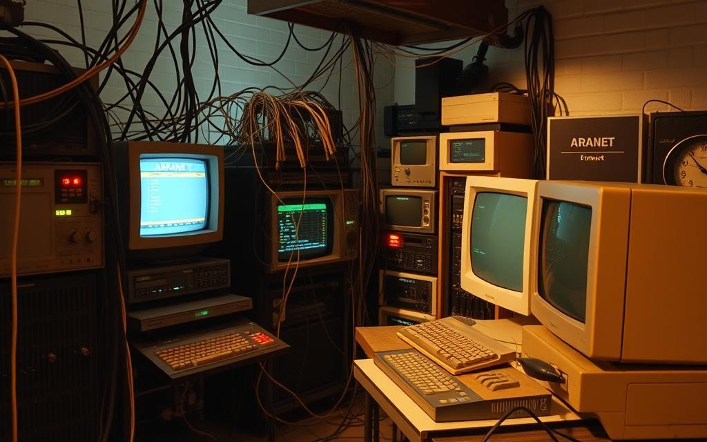

<div align="center">

# `nataliamanenti`

### `> curiosity-driven.`

**Systems Analysis and Computer Science Student**

<br>


</div>

---

```bash
$ whoami
nataliamanenti

$ cat about.txt
```

I'm a Systems Analysis and Computer Science student with a deep
interest in computers, mathematics, hardware, and art.

I enjoy understanding how things work, taking hardware
apart, experimenting with components and exploring the
relationship between technology and creativity.

I'm particularly interested in Machine Learning, Cloud
Computing, and the technical side of 3D graphics and
animation, including Blender, Unreal Engine, and
animation pipelines.

I also have a soft spot for the analog side of things.
I appreciate physical objects, hands-on experimentation,
and the process of learning something from the ground up.

---

## `01 / interests`

| Area | What draws me to it |
|---|---|
| Machine Learning | Mathematics, patterns, data, models and experimentation |
| Computer Hardware | Components, hardware enclosures, tinkering and hands-on experiments |
| Cloud Computing | Infrastructure, systems and how applications run at scale |
| Mathematics | Logic, problem-solving and the foundations behind computing |
| Creative Technology | Digital art, Blender, Unreal Engine and animation pipelines |
| Analog & Physical Computing | Physical experimentation and the relationship between hardware and software |

---

## `02 / my environment`

**Operating System**


**Programming & Development**


**Creative Tools & Exploration**


---

## `03 / projects & experiments`

A growing collection of things I'm building, testing,
breaking, and learning from.

My projects will mainly explore:

- Machine Learning and data-driven experiments.
- Algorithm implementation and performance analysis.
- Cloud infrastructure and deployment.
- Hardware-related experiments.
- 3D workflows and animation pipelines.

---

## `04 / learning & research`

Some of my favorite ways to learn:

- Reading official technical documentation.
- Exploring technical forums and developer communities.
- Studying books and academic material.
- Building small experiments and testing ideas.
- Learning from other people's implementations.
- Using AI tools as complementary learning and research resources.

---

## `05 / currently exploring`

- Machine Learning foundations and mathematics.
- Python for data science and experimentation.
- Cloud Computing and infrastructure.
- Linux systems and development environments.
- Blender, Unreal Engine and animation pipelines.

---

## `06 / a few things I believe in`

```text
Understand the machine.
Read the documentation.
```
